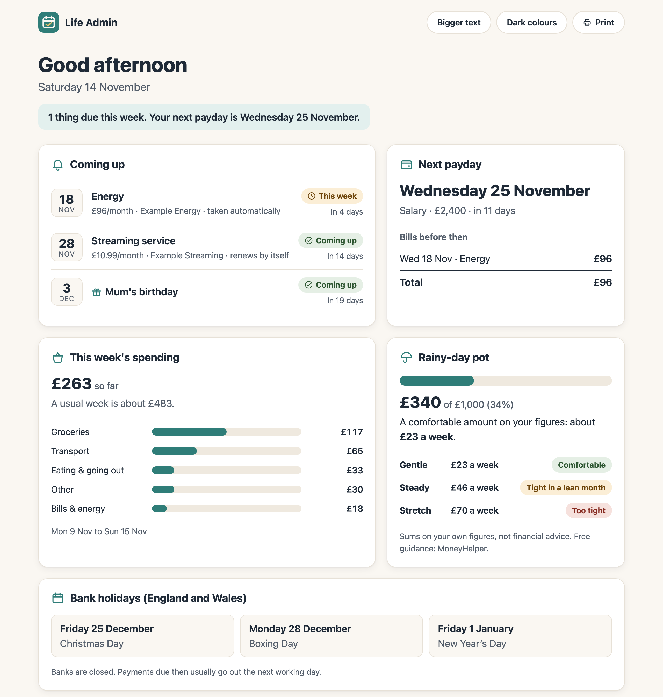

# Life Admin MCP

**Never miss a bill, never pay a loyalty penalty, and always know what's safe to spend.**

Your bills, renewals, subscriptions, birthdays and spending, kept as plain files on your own computer, and looked after by your AI assistant (Claude Code, Claude Desktop, Cursor, VS Code or any [MCP](https://modelcontextprotocol.io) client). Made for the UK.

> **Work in progress (0.1.0, not yet published).** Everything below works and is tested; publishing comes next.



## What it does

- **Remembers the dates.** Renewals, bills, subscriptions, warranties, MOT, passport, birthdays and appointments, with reminders in your own calendar.
- **Bills before payday.** Lists what goes out before your next pay or pension, and moves payday to the working day before when it falls on a weekend or bank holiday.
- **Shows where the money goes.** Import a bank statement (every UK bank app can export one) and see this week or month by category, compared with what's usual for you.
- **Rainy-day planner.** Spreads big yearly bills into monthly amounts, then suggests Gentle, Steady or Stretch saving amounts, each checked against your tightest recent month.
- **Spots price rises.** Records the old and new price at every renewal, so loyalty penalties are visible.
- **A calm home screen.** Large text, plain words, light and dark colours, and a Print button for the fridge.
- **UK bank holidays** for England and Wales, Scotland and Northern Ireland, built in.

## Try it

Ask your assistant things like:

- *"Add my car insurance: £412 a year, renews 3 March."*
- *"What's coming up this month?"*
- *"Import my bank statement from Downloads."*
- *"How much could I put aside for a rainy day?"*
- *"Put my renewals in my calendar."*
- *"Show me my home screen."*

## Install in Claude Desktop (easiest)

No technical steps, and nothing else to install: Claude Desktop includes everything it needs.

1. Install [Claude Desktop](https://claude.ai/download) and sign in.
2. Download **`life-admin.mcpb`**.
3. **Double-click it.** Claude opens and asks two things:
   - *Where to keep your life admin:* leave it as it is.
   - *Where in the UK do you live?* Type England, Wales, Scotland or Northern Ireland.
4. Click **Install**, then start a new chat and try: *"Show me my home screen."*

Helping someone set up? Do steps 1 to 4 with them once; after that they just talk to Claude.

## Set up for developers (from a checkout)

```bash
npm install && npm run build
node dist/index.js init        # creates ~/LifeAdmin and prints the line to connect your assistant
node dist/index.js doctor      # checks everything, including a live connection test
node dist/index.js dashboard   # opens the home screen in your browser
```

Also: `due` prints what's coming up, and `ics` writes a calendar file. Set `LIFE_ADMIN_REGION` to `Scotland` or `Northern Ireland` for local bank holidays. `npm run bundle` builds the one-click `life-admin.mcpb` and checks it by installing it the way Claude Desktop does.

## Tools

| Area | Tools |
| --- | --- |
| Dates and renewals | `due_soon`, `add_item`, `get_item`, `update_item`, `mark_handled`, `search_items`, `list_items`, `delete_item`, `restore_item` |
| Money | `import_bank_file`, `add_spending`, `categorise`, `spending_summary`, `money_ahead`, `rainy_day_plan`, `update_pot` |
| Calendar and screen | `export_calendar`, `bank_holidays`, `open_home_screen`, `get_stats` |

Item types: bill, renewal, subscription, policy, warranty, vehicle, document, income, birthday and reminder.

## Agent skill

Tools are only half of it: an assistant also needs to know *how* to use them well. [`skill/life-admin/`](skill/life-admin) is a free `SKILL.md` that teaches it to never invent dates or prices, keep card numbers out, ask before importing or deleting, never promise a reminder it can't send, and treat pushy "pay now" emails as possible scams. Copy the folder into your assistant's skills directory, or build a zip with `npm run package-skill`.

A test checks the skill against the live server, so every tool and argument it names really exists. `npm run eval:skill` runs behaviour scenarios in real Claude sessions (needs the `claude` CLI signed in).

## Private and careful by design

- **Stays on your computer.** Plain markdown and CSV files in `~/LifeAdmin` that open in any editor or Excel. The server never uses the internet, and the home screen only answers this computer.
- **No full card numbers.** Card numbers are refused or masked to the last four digits.
- **Never invents figures.** Every amount comes from your own records or what you typed. Impossible dates are flagged, never quietly changed.
- **Budgeting help, not financial advice.** The planner does sums on your own figures and never recommends financial products. It points to free help: MoneyHelper, and StepChange for debt.
- **Reminders you can trust.** An AI assistant can't nudge you by itself, so reminders go into your own calendar. Repeats match the app's own date logic exactly, and month ends stay right (31 Jan → 28 Feb → 31 Mar).
- **Safe to undo.** Deleted items go to a trash folder and can be restored. Bank imports preview before saving and skip duplicates.

## Development

```bash
npm test         # build, then unit, CLI, calendar, dashboard and end-to-end MCP tests
npm run format   # prettier
```

`LIFE_ADMIN_TODAY=YYYY-MM-DD` pretends it's another day (for tests and demos). `npx tsx scripts/make-demo-money.ts` rebuilds the fictional demo spending.

Bank holiday dates come from [gov.uk](https://www.gov.uk/bank-holidays): contains public sector information licensed under the Open Government Licence v3.0.

## Licence

MIT
